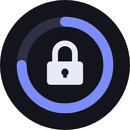
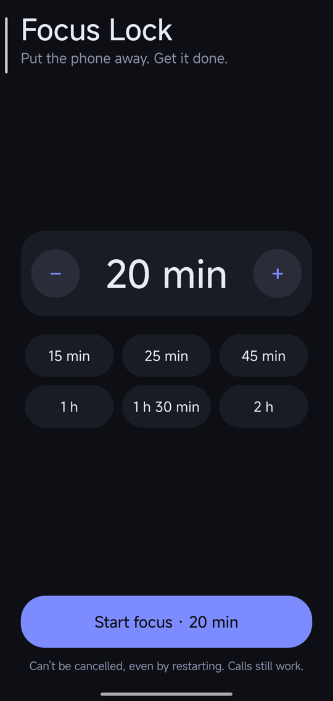

<p align="center"></p>

<h1 align="center">Focus Lock</h1>

<p align="center">Lock your Android phone for a set time. No apps, no cancelling, not even a restart gets you out — just a timer until you're done.</p>

<p align="center"></p>

## Features

- **Whole-phone lock** — a full-screen timer covers every app, the home screen, recents and the notification shade.
- **Survives restarts** — the lock comes back as soon as the phone is unlocked after a reboot.
- **Any duration** — type 1–720 minutes, use − / +, or tap a preset (15 min to 2 h).
- **Progress ring** with time remaining and the exact unlock time.
- **Calls always work** — an *Emergency call* button opens the dialer (111), and the phone app stays usable for incoming and outgoing calls.
- **Private by design** — no internet permission, no account, no tracking, no ads. Nothing leaves your phone.
- **Tiny** — plain Kotlin and the Android SDK, no third-party libraries.

## How it works

Focus Lock runs as an Android **accessibility service**. While a session is active it draws an
accessibility overlay above everything else on screen, so Home, Back and Recents still work but only
reveal the timer. The end time is saved, and Android re-starts enabled accessibility services after a
reboot, so the lock resumes automatically. Phone/dialer apps are allowed through so calls are never
blocked.

## Install

1. Build or download the APK and install it.
2. Android 13+ blocks accessibility for sideloaded apps. Open **Settings → Apps → Focus Lock → ⋮ → Allow restricted settings**.
3. Open **Settings → Accessibility → Focus Lock** and turn it on.
4. Open Focus Lock, pick a time, tap **Start focus**, then **Lock**.

With adb you can do steps 2–3 in one go:

```bash
adb install app-release.apk
adb shell appops set nz.dronepilot.focuslock ACCESS_RESTRICTED_SETTINGS allow
adb shell settings put secure enabled_accessibility_services nz.dronepilot.focuslock/.FocusService
adb shell settings put secure accessibility_enabled 1
```

> The last two commands **replace** your list of enabled accessibility services. If you already use others, enable Focus Lock from Settings instead.

## Build

Requires JDK 17 and the Android SDK (compileSdk 36, minSdk 30).

```bash
./gradlew :app:testDebugUnitTest :app:assembleRelease
# APK: app/build/outputs/apk/release/app-release.apk
```

## Getting out early

The lock is meant to be hard to escape, but not impossible in a real emergency:

- **Safe mode** (hold Volume Down while the phone boots on most devices) disables third-party apps, including Focus Lock.
- **adb**: `adb uninstall nz.dronepilot.focuslock`.
- Sessions are capped at 12 hours so a typo can't lock the phone for days.

## Limitations

- Android only. Tested on a Redmi K80 Pro (HyperOS / Android 16).
- Google Play restricts accessibility services for non-accessibility apps, so this is distributed as a sideloaded APK.
- The emergency number is hard-coded to 111 (New Zealand). Change it in `FocusService.kt` for other countries.

## License

[MIT](LICENSE)
